```{r,include=FALSE,purl=FALSE}
suppressPackageStartupMessages(require(knitr))
knitr::opts_chunk$set(echo = TRUE, tidy = FALSE)
```

```{=html}
<style>
.reveal pre code {
  max-height: none;
  /* font-size: 0.75em; */
}
</style>
```

::: {.content-hidden when-format="revealjs"}
# Single-cell ATAC-seq: Cell Ranger and Data Import to R
:::


# Set Up {background-color="#23373B" .center .middle}

## Materials

All prerequisites, links to material and slides for this course can be found on github.

* [scATAC](https://rockefelleruniversity.github.io/scATAC/)

Or can be downloaded as a zip archive from here.

* [Download zip](https://github.com/RockefellerUniversity/scATAC/archive/refs/heads/master.zip)

## Course materials

Once the zip file is unarchived, all presentations as HTML slides and pages, their R code and HTML practical sheets will be available in the directories underneath.

* **docs/presentations/slides/**
Presentations as an HTML slide show.
* **docs/presentations/singlepage/**
Presentations as an HTML single page.
* **docs/presentations/r_code/**
R code in presentations.
* **docs/exercises/**
Practicals as HTML pages.
* **docs/answers/**
Practicals with answers as HTML pages and R code solutions.

## Set the Working directory

Before running any of the code in the practicals or slides we need to set the working directory to the folder we unarchived.

You may navigate to the unarchived scATAC folder in the Rstudio menu.

**Session -> Set Working Directory -> Choose Directory**

or in the console.

```{r setwd_introtoR,eval=F}
setwd("/PathToMyDownload/scATAC-master/docs")
# e.g. setwd("~/Downloads/scATAC-master/docs")
```

## Overview

- [Introduction to single cell ATAC sequencing](#introduction-to-single-cell-atac-sequencing)
- [10x platform](#tenx-platform)
- [Cell Ranger](#cell-ranger)
- [Cell Ranger Output Files](#cell-ranger-output-files)
- [Cell Ranger Web Summary](#cell-ranger-web-summary)
- [Reading data into R with Signac](#reading-data-into-r-with-signac)

# Introduction to single cell ATAC sequencing {background-color="#23373B" .center .middle}

## ATACseq

::: {.columns}

::: {.column width="70%"}
ATACseq (Assay for Transposase-Accessible Chromatin using sequencing) uses the Tn5 transposase to fragment accessible DNA and add a sequencing adapter to the end of these fragments (called tagmentation).

<br>
Since the transposase only cuts DNA that is not blocked by nucleosomes or proteins, this generates a map of the accessible/open chromatin genome wide (e.g. promoters and enhancers).

::: {style="font-size: 30%;"}
source: [ Active Motif](https://www.activemotif.com/catalog/1233/atac-seq-service?srsltid=AU7gw4VmzovGlTISSNIyIQvgYFxdtaTpxkt0jU1eobR2YcCprNn74jIR){target="_blank"}
:::
:::

::: {.column width="30%"}
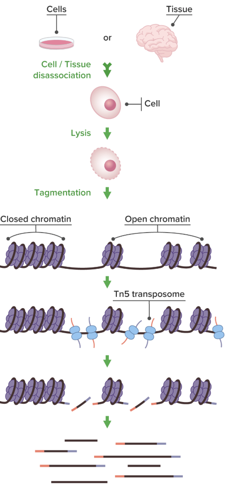
:::

:::


## Sequencing overview


The emergence of high-throughput sequencing technologies such as 454 in 2005 (Roche) and Solexa in 2006 (now Illumina) sequencing allowed for the highly parallel short read sequencing of DNA molecules.

Illumina is now the dominant company for short read sequencing with NovaSeq, NextSeq, and MiSeq machines. 

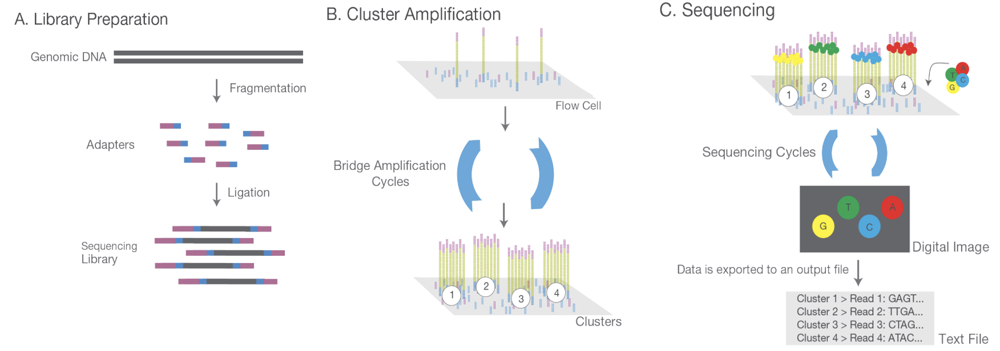{.nostretch fig-align="center"}

::: {style="font-size: 30%;"}
source: [Illumina](https://www.illumina.com/documents/products/illumina_sequencing_introduction.pdf){target="_blank"}
:::


## Sequence files - FastQ
 **FastQ (FASTA with Qualities)**
 
<div align="center">
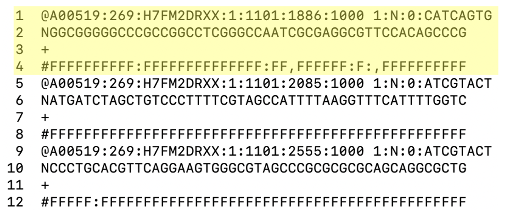
</div>

- "@" followed by identifier
- Sequence information
- "+" 
- Quality scores encoded as ASCII


## Sequence files - FastQ
 **FastQ - Header**
 
<div align="center">
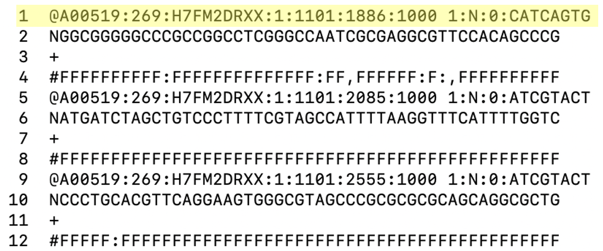
</div>

- Header for each read contains additional information

    - @A00519:269:H7FM2DRXX:1:1101:1886:1000 - machine/flowcell/lane/cluster info
    - 1:N:0:CATCAGTG - Read info (Read 1/2, index, etc.)
    


## Sequence files - FastQ

**FastQ - Qualities**

<div align="center">
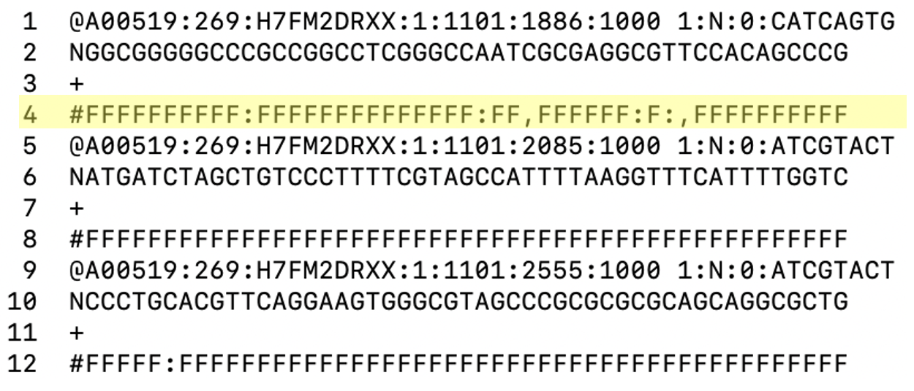
</div>
 
- Encoded in ASCII to save space.
- Used in quality assessment and downstream analysis
- −10·log10(probability of base being wrong)
- For example, (Q)30 = -10*log10(0.001), or 1 in 1000 change of being wrong
 


## Bulk sequencing methods

For many years, NGS sequencing was performed on bulk tissue or cells (e.g. RNA-seq, ChIP-seq, ATAC-seq). 

This effectively allows us to understand differences between tissues, conditions (cancer vs healthy), treatments (drug vs control), or genetic perturbations (WT vs KO). 

However, analysis of the bulk characteristics of data prevents an understanding of the heterogeneity of a sample.


## FACS Cell and Nuclei sorting

Technologies such as TRAP from the Heintz lab or nuclei sorting allow for capture of distinct cell types based on expressed markers.

*Pros:*

- Allow for the capture of rare cell populations such as specific neuron types.

*Cons:*

- Require known markers for desired cell populations.


## Single-cell sequencing

With the advent of advanced microfluidics and refined sequencing technologies, single-cell sequencing has emerged as a technology to profile individual cells from a heterogeneous population without prior knowledge of cell populations.

*Pros:*

- No prior knowledge of cell populations required.
- Simultaneously assess profiles of 1000s of cells.

*Cons:*

- Low sequencing depth for individual cells (1000s vs millions of reads for bulk). 


## Single-cell use cases

Single-cell sequencing, as with bulk sequencing, has now been applied to the study of a wide range of differing assays.

- scRNA-seq/snRNA-seq - Transcriptomics
- **scATAC-seq/snATAC-seq - Chromatin accessibility**
- scCUT&TAG - Histone modifications/TF binding
- AIRR - TCR/BCR profiling
- Spatial-seq - Spatial profiling of gene expression.


# 10x platform {#tenx-platform background-color="#23373B" .center .middle}

## Single-cell platforms

- **10x Genomics - droplet/microfluidics**
- sci-ATAC-seq - Combinatorial Indexing 
- BD Rhapsody - microwell based

10x is the most popular and is known to produce high quality data. 

<br>

Combinatorial methods scale better, don't require specialized equipment, and are more cost effective. Though they lack a developed commercial product right now for scATAC.  


## The 10x Genomics system  - Gel beads

::: {.columns}

::: {.column width="40%"}

10x relies on gel beads that are coated with oligos containing: 

- the Illumina P5 sequence
- a 16 bp barcode
- Read 1N, which is the sequence added by Tn5 during tagmentation 

::: {style="font-size: 30%;"}
source: [ 10x scATAC User Guide](https://cdn.10xgenomics.com/image/upload/v1728078402/support-documents/CG000496_Chromium_NextGEM_SingleCell_ATAC_ReagentKits_v2_UserGuide_RevC.pdf.pdf){target="_blank"}
:::
:::

::: {.column width="60%"}
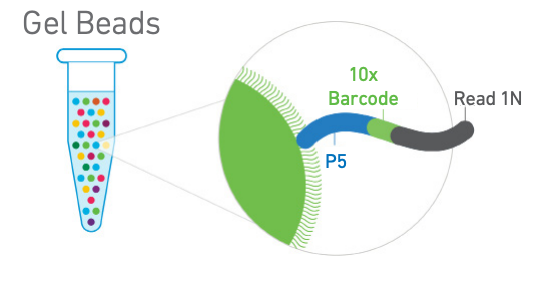{.nostretch fig-align="center" style="max-width: none; max-height: none; width: 100%;"}

:::

:::


## The 10x Genomics system - Microfluidics

::: {.columns}

::: {.column width="40%"}
::: {style="font-size: 90%;"}
- DNA within nuclei is fragmented in bulk with transposase
- Nuclei are loaded onto a 10x chip with gel beads (targeting 500–10k nuclei per channel)
- Beads + nuclei are partitioned by oil into Gel Beads-in-EMulsions (GEMs)
:::
:::

::: {.column width="60%"}
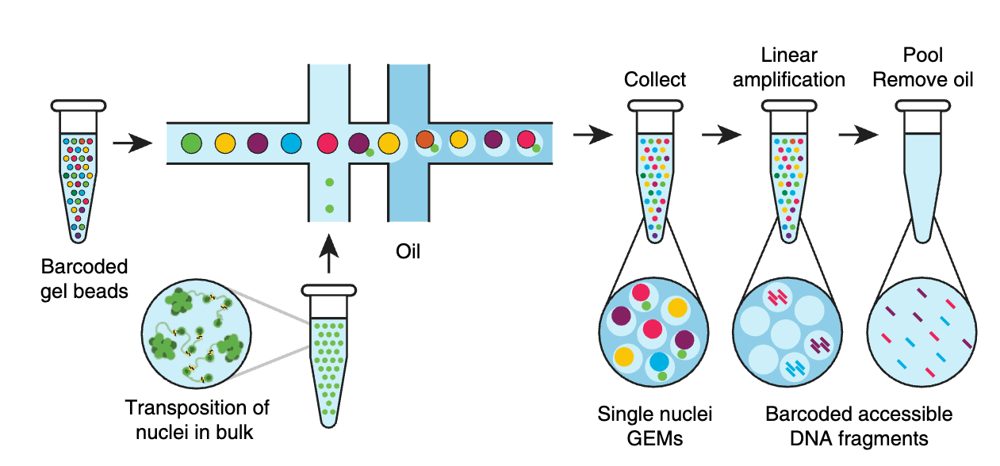
:::

:::

::: {style="font-size: 30%;"}
[Satpathy et al., Nat. Biotechnology, 2019](https://pubmed.ncbi.nlm.nih.gov/31375813/){target="_blank"}
:::

## The 10x Genomics system  - Amplification within GEM

::: {.columns}

::: {.column width="50%"}
::: {style="font-size: 90%;"}
<br>
<br>
- Inside the GEM, the P5 sequence and the cell barcode are added to each fragment through binding of the bead's Read1N to the Tn5 adapter followed by linear amplification.  

:::
:::

::: {.column width="50%"}
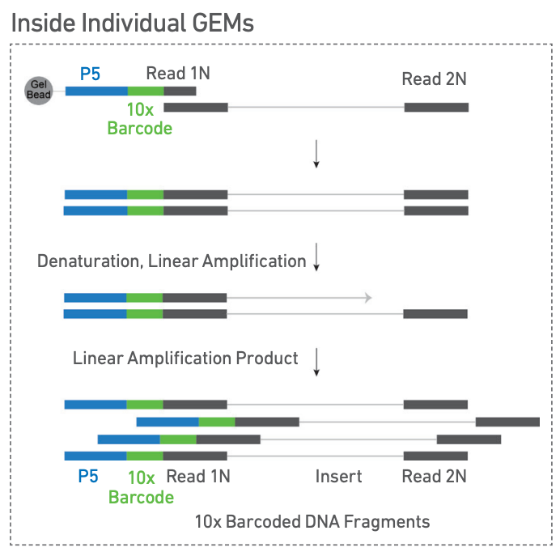{style="max-width: none; max-height: none; width: 100%;"}
:::
:::

::: {style="font-size: 30%;"}
source: [ 10x scATAC User Guide](https://cdn.10xgenomics.com/image/upload/v1728078402/support-documents/CG000496_Chromium_NextGEM_SingleCell_ATAC_ReagentKits_v2_UserGuide_RevC.pdf.pdf){target="_blank"}
:::


## The 10x Genomics system  - Sample/Pool amplification in bulk

::: {.columns}

::: {.column width="50%"}
::: {style="font-size: 90%;"}
<br>
- The GEMs are then chemically broken, and the P7 sequence and sample index are added in bulk via the Read 2N Tn5 adapter sequence by PCR.

<br>

- Now we have an amplified library that is sequenced to capture the sample index, cell barcode, and both ends of the fragment. 
:::
:::

::: {.column width="50%"}
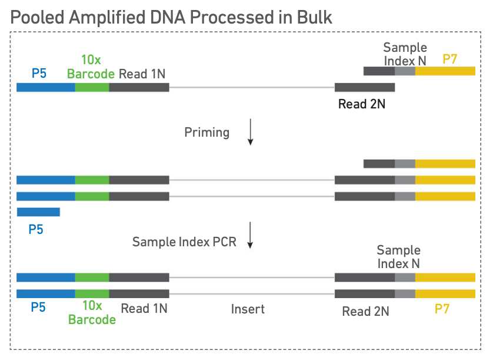{style="max-width: none; max-height: none; width: 100%;"}
:::
:::


::: {style="font-size: 30%;"}
source: [ 10x scATAC User Guide](https://cdn.10xgenomics.com/image/upload/v1728078402/support-documents/CG000496_Chromium_NextGEM_SingleCell_ATAC_ReagentKits_v2_UserGuide_RevC.pdf.pdf){target="_blank"}
:::

## Download PBMC data from 10x

Today we will be looking at data from 500 Peripheral Blood Mononuclear Cells (PBMC) downloaded from the 10x website ([link to dataset](https://www.10xgenomics.com/datasets/500-peripheral-blood-mononuclear-cells-pbm-cs-from-a-healthy-donor-next-gem-v-1-1-1-1-standard-2-0-0){target="_blank"}).

```{shell, eval=F}
wget https://cf.10xgenomics.com/samples/cell-atac/2.0.0/atac_pbmc_500_nextgem/atac_pbmc_500_nextgem_fastqs.tar
```

<br>
<br>

Unpack this folder, which contains the FASTQ files. 

```{shell, eval=FALSE}
tar -xvf atac_pbmc_500_nextgem_fastqs.tar 
```


## The 10x sequence reads

::: {style="font-size: 90%;"}


- Information on sample identity (Index read - I1)
  + this is used for demultiplexing, usually handled by [Illumina's BCL Convert software](https://www.10xgenomics.com/support/software/cell-ranger-atac/latest/analysis/inputs/direct-demultiplexing-with-illumina-software){target="_blank"}
:::

```{=html}
<pre class="tree">
atac_pbmc_500_nextgem_fastqs/
├── <mark>atac_pbmc_500_nextgem_S1_L001_I1_001.fastq.gz ← sample index </mark>
├── atac_pbmc_500_nextgem_S1_L001_R1_001.fastq.gz ← fragment read 1
├── atac_pbmc_500_nextgem_S1_L001_R2_001.fastq.gz ← cell barcode
└── atac_pbmc_500_nextgem_S1_L001_R3_001.fastq.gz ← fragment read 2
</pre>
```


## The 10x sequence reads

::: {style="font-size: 90%;"}


- [Information on sample identity (Index read - I1)]{style="color: grey;"}
  + [this is used for demultiplexing, usually handled by [Illumina's BCL Convert software](https://www.10xgenomics.com/support/software/cell-ranger-atac/latest/analysis/inputs/direct-demultiplexing-with-illumina-software){target="_blank"}]{style="color: grey;"}
- Information on the DNA fragment (accessible region read - paired R1 and R3)
:::

```{=html}
<pre class="tree">
atac_pbmc_500_nextgem_fastqs/
├── atac_pbmc_500_nextgem_S1_L001_I1_001.fastq.gz ← sample index 
├── <mark>atac_pbmc_500_nextgem_S1_L001_R1_001.fastq.gz ← fragment read 1</mark>
├── atac_pbmc_500_nextgem_S1_L001_R2_001.fastq.gz ← cell barcode
└── <mark>atac_pbmc_500_nextgem_S1_L001_R3_001.fastq.gz ← fragment read 2</mark>
</pre>
```

## The 10x sequence reads

::: {style="font-size: 90%;"}


- [Information on sample identity (Index read - I1)]{style="color: grey;"}
  + [this is used for demultiplexing, usually handled by [Illumina's BCL Convert software](https://www.10xgenomics.com/support/software/cell-ranger-atac/latest/analysis/inputs/direct-demultiplexing-with-illumina-software){target="_blank"}]{style="color: grey;"}
- [Information on the DNA fragment (accessible region read - paired R1 and R3)]{style="color: grey;"}
- Information on cell identity (10x barcode - R2)
:::

```{=html}
<pre class="tree">
atac_pbmc_500_nextgem_fastqs/
├── atac_pbmc_500_nextgem_S1_L001_I1_001.fastq.gz ← sample index 
├── atac_pbmc_500_nextgem_S1_L001_R1_001.fastq.gz ← fragment read 1
├── <mark>atac_pbmc_500_nextgem_S1_L001_R2_001.fastq.gz ← cell barcode</mark>
└── atac_pbmc_500_nextgem_S1_L001_R3_001.fastq.gz ← fragment read 2
</pre>
```

## The 10x sequence reads

::: {style="font-size: 90%;"}


- [Information on sample identity (Index read - I1)]{style="color: grey;"}
  + [this is used for demultiplexing, usually handled by [Illumina's BCL Convert software](https://www.10xgenomics.com/support/software/cell-ranger-atac/latest/analysis/inputs/direct-demultiplexing-with-illumina-software){target="_blank"}]{style="color: grey;"}
- [Information on the DNA fragment (accessible region read - paired R1 and R3)]{style="color: grey;"}
- [Information on cell identity (10x barcode - R2)]{style="color: grey;"}
:::

```{=html}
<pre class="tree">
atac_pbmc_500_nextgem_fastqs/
├── atac_pbmc_500_nextgem_S1_L001_I1_001.fastq.gz ← sample index 
├── atac_pbmc_500_nextgem_S1_L001_R1_001.fastq.gz ← fragment read 1
├── <mark>atac_pbmc_500_nextgem_S1_L001_R2_001.fastq.gz ← cell barcode</mark>
└── atac_pbmc_500_nextgem_S1_L001_R3_001.fastq.gz ← fragment read 2
</pre>
```

::: {.callout-note}
- NOTE: no UMI is needed because only two copies of a fragment in diploid cell and the fragment's start/end coordinates plus the cell barcode act like a UMI
:::


## From Sequences to Processed data

::: {style="font-size: 90%;"}
Similar to standard ATAC sequencing, now that we have our FASTQ files the next steps are to align the data to a reference genome and call peaks. 

Single cell ATAC requires the additional steps of identifying cells and summarizing data to a cell by peak count matrix.

<br>
Software options for these steps include:

- Cell Ranger ATAC (from 10x) aligns to a reference (uses BWA), generates fragments, and calls peaks using fragments pooled from all barcodes.
- [chromap](https://github.com/haowenz/chromap){target="_blank"} is another scATAC-centric software to get fragments. Its lighter weight and faster, though cell and peak calling is done manually
- custom alignment  
:::


# Cell Ranger {background-color="#23373B" .center .middle}

## Cell Ranger ATAC

Cell Ranger ATAC is the typical approach we use to process 10x data that works well out of the box. This is an intensive program that is only available for Linux machines, so we will not be running this locally on your laptops. Instead we run it on remote systems, like the HPC.

<br>
If you are working with your own data, the data will often be provided as the Cell Ranger output by the Genomics/Bioinformatics teams, like here at Rockefeller University. 


## Cell Ranger ATAC

::: {.columns}

::: {.column width="50%"}

Cell Ranger is a suite of tools for single cell processing and analysis available from 10X Genomics. It performs key processing steps and is also the first chance to delve into your data set's QC. 
<br>
<br>
In this session we will give a brief overview of running this tool and then dive deeper into interpreting the outputs.
:::

::: {.column width="50%"}
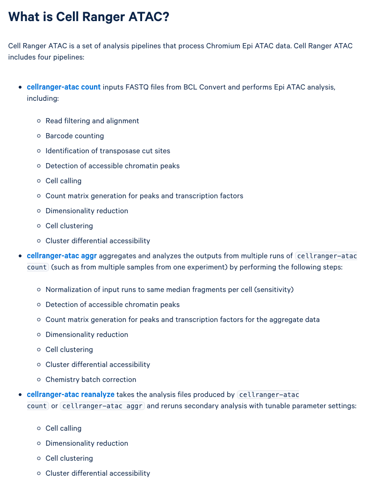
:::

:::

## Do I need to run this?

- Often genomics centers will run it for you and deliver mtx/hdf5 files (e.g. here at Rockefeller)

- Why run Cell Ranger yourself?:
  * You want to integrate data sets, but they were processed by different versions of Cell Ranger
  * You may want to change Cell Ranger parameters (e.g. supply your own peak set or force an expected cell number)
  * Most commonly you want to reanalyze a published data set


## Cell Ranger ATAC Download

::: {.columns}

::: {.column width="50%"}
- Cell Ranger is available from the [10x genomics website](https://www.10xgenomics.com/support/software/cell-ranger-atac/downloads){target="_blank"}.

- Also available are pre-baked references for Human and Mouse genomes (GRCh38 and GRCm38/9)
:::

::: {.column width="50%"}

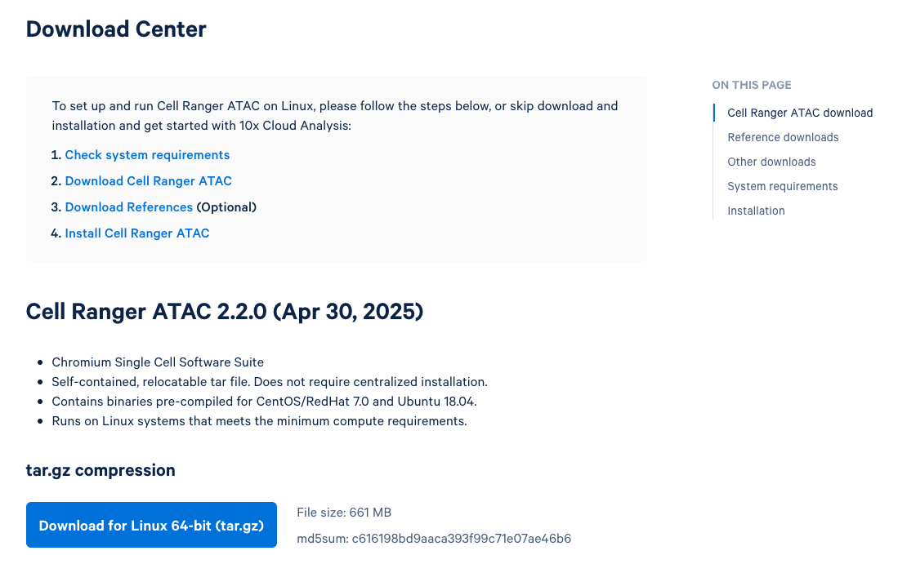

:::

:::

## Cell Ranger ATAC Download

- Cell Ranger only runs on linux machines (CentOS/RedHat 7.0+ and Ubuntu 14.04+).
- Due to memory requirements, typically users run Cell Ranger on a remote server and not their own machines
- To download Cell Ranger and the required reference onto a remote server, we typically use the *wget* command (these commands are all on the [Download](https://www.10xgenomics.com/support/software/cell-ranger-atac/downloads){target="_blank"} page)

[This will all be in terminal on the server you are using]

```{shell, eval=FALSE}
wget -O cellranger-atac-2.2.0.tar.gz "https://cf.10xgenomics.com/releases/cell-atac/cellranger-atac-2.2.0.tar.gz?Expires=1790236407&Key-Pair-Id=APKAI7S6A5RYOXBWRPDA&Signature=KD5CNhBTKkkdwbdJkXjVmf-ybpjwUJ8~MsVSCf2dL~cW7j8LGc0PMWz6arvTTzNq0u5ZBMzqI02L3KBS6-pImXFwegQ8VxN4RPGVCY-V1UvWD~NqYEFsdBcCM~EeJKbd9sGOlTklk7xQ9XdP0tHZnBLpixC3BjqH~ymDcZZSc6RqBWy3kCQ7uzGWi-PQPKEYLbPS4Pd-enmFbgPplDYjHPmmpa5S7nCegzlfYBnYOnYN8iahjsTkOxrYv~KWf4g9uKVU-Z~lW-gx7mt2RIHfVfTy9zLnmdb~AC-xtryUH6jyPvN7nxpaQw3FchRaXtIZVNm59UfPfIstIRrgcDqhBw__"
```


## Cell Ranger ATAC Reference

Download reference genome for Cell Ranger i.e. Human genome (GRCh38)

- Below we download the reference from 10x designed for multiome analysis (ATAC + RNA, referred to on 10x as the *ARC* pipeline). 
- It is also used for cellranger-atac, and contains elements that are specific to ATAC analysis, such as genome alignment, TSS enrichment, and motifs.

```{shell, eval=FALSE}
wget "https://cf.10xgenomics.com/supp/cell-arc/refdata-cellranger-arc-GRCh38-2024-A.tar.gz"
```


## Cell Ranger set-up

Having downloaded the software and references, we can then unpack them.

```{shell, eval=FALSE}
tar -xzvf cellranger-atac-2.2.0.tar.gz
tar -xzvf refdata-cellranger-arc-GRCh38-2024-A.tar.gz
```

<br>
<br>
Finally we can add the cellranger directory to our PATH.

```{shell, eval=FALSE}
export PATH=/PATH_TO_CELLRANGER_DIRECTORY/cellranger-atac-2.2.0:$PATH
```


## Running Cell Ranger ATAC count

 <br>
 <br>
Now we have the downloaded Cell Ranger software and the reference we can start the processing of our FASTQ files.
 <br>
 <br>
With the Cell Ranger software and pre-built reference files, we can generate fragments and counts from our directory of FASTQ files.

## Running Cell Ranger ATAC count

The *cellranger-atac count* function will align reads (with BWA), call peaks, and make a count matrix and associated files.

::: {style="font-size: 80%;"}
- --id will be used to name output files
- the --sample argument is used to select samples from the fastq folder. 
  + fastq filenames with this string will be used and multiple names can be separated by commas
:::

```{shell, eval=FALSE}
cellranger-atac count --id=pbmc_500 \
   --sample atac_pbmc_500_nextgem \
   --fastqs=PATH_TO_FASTQ_DIRECTORY \
   --reference=/PATH_TO_CELLRANGER_DIRECTORY/refdata-cellranger-arc-GRCh38-2024-A
```


## Working with custom genomes

If you are working with a genome which is not human or mouse you will need to find another source for your Cell Ranger reference.

- Luckily many references are pre-built by other consortiums.
- We can build our own references using other tools in Cell Ranger using the *mkref* functions.
- For this you just need a FASTA file (DNA sequence) and a GTF file (Gene Annotation) for your reference.


## Creating your own reference

To create your own references you will need two additional files.

- FASTA file - File containing the full genome sequence for the reference of interest
- GTF file - File containing the gene/transcript models for the reference of interest.


## FASTA file (Genome sequence)

- The reference genome stored as a collection of contigs/chromosomes.
- A contig is a stretch of DNA sequence encoded as A,G,C,T,N.
- Typically comes in FASTA format.
    - ">" line contains information on contig
    - Lines following contain contig sequence

<div align="center">
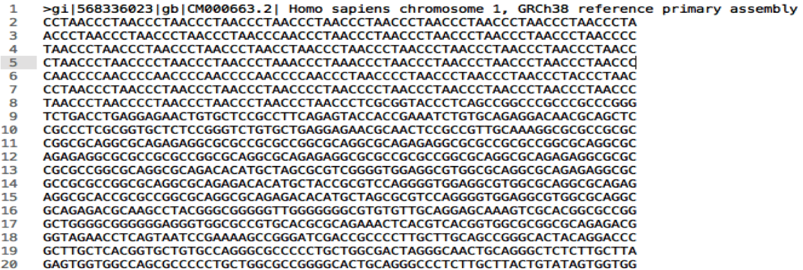
</div>


## GTF (Gene Transfer Format)

- Stores position, feature (exon) and meta-feature (transcript/gene) information.
- Used in scATAC for locating TSSs and annotating peaks to genes
- Column 9 holds key–value attributes, including the **gene_biotype** used for filtering.


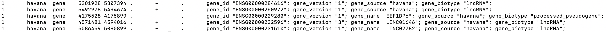{.nostretch fig-align="center" style="max-width: none; max-height: none; width: 100%;"}

::: {style="font-size: 30%;"}
Ensembl GRCh38 release 116 GTF
:::

## Filter GTF

An optional step is to clean up the GTF by removing unwanted or low-confidence annotations. This can be done manually by filtering the GTF *gene_biotype* column to key types, such as 'protein_coding' and 'lncRNA'. 
<br>
<br>
 
Manual filtering of GTF files can done by reading into or exporting from R using the *import* and *export* functions from the rtracklayer package. 
<br>
<br>
10x also provides scripts [at this link](https://www.10xgenomics.com/support/software/cell-ranger-atac/downloads/ref-build-steps) showing how their references are built and filtered. 


## Generate Cell Ranger mkref config file


Following filtering of your GTF to the required biotypes, we can use the Cell Ranger ATAC *mkref* tool to create our custom reference. This requires a config file with key:value pairs. 

::: {style="font-size: 80%;"}
  - The *non_nuclear_contigs* pair indicates which contigs are not part of nuclear genome and reads aligning to them will be excluded from peak calling. 
  - The *input_motifs* pair is optional and will trigger an additional TF enrichment analysis.
:::

```{shell, eval=FALSE}
{
  organism: "human"
  genome: ["GRCh38"]
  input_fasta: ["/path/to/GRCh38/Homo_sapiens.GRCh38.dna.primary_assembly.fa.gz"]
  input_gtf: ["/path/to/Homo_sapiens.GRCh38.ensembl.filtered.gtf"]
  non_nuclear_contigs: ["MT"]
  input_motifs: "/path/to/jaspar/motifs.pfm"
}

```


## Run Cell Ranger mkref 

The key:value pairs in the previous slide are saved as a file called **custom_GRCh38.config** and it is included in the *cellranger-atac mkref* function call. 
```{shell, eval=FALSE}

cellranger-atac mkref --config=/path/to/references/custom_GRCh38.config

```

# Cell Ranger Output Files {background-color="#23373B" .center .middle}


## Cell Ranger ATAC outputs


::: {.columns}

::: {.column width="50%"}
Having completed running *cellranger-atac count*, we will have created a folder with the name set by the **--id** flag in the function call.
<br>
Within this folder there will be the **outs/** directory and descriptions of each file/folder can be found [here](https://www.10xgenomics.com/support/software/cell-ranger-atac/latest/analysis/outputs/understanding-output){target="_blank"}
<br>
We will go through the files generally used in our downstream processing.
:::

::: {.column width="50%"}
```{=html}
<pre class="tree">
outs/
├── analysis
├── cloupe.cloupe
├── cut_sites.bigwig
├── filtered_peak_bc_matrix/
├── filtered_peak_bc_matrix.h5
├── filtered_tf_bc_matrix/
├── filtered_tf_bc_matrix.h5
├── fragments.tsv.gz
├── fragments.tsv.gz.tbi
├── peak_annotation.tsv
├── peak_motif_mapping.bed
├── peaks.bed
├── possorted_bam.bam
├── possorted_bam.bam.bai
├── raw_peak_bc_matrix/
├── raw_peak_bc_matrix.h5
├── singlecell.csv
├── summary.csv
├── summary.json
└── web_summary.html
</pre>
```
:::

:::

## Output files - Fragments


::: {.columns}

::: {.column width="50%"}

::: {style="font-size: 80%;"}
- **fragments.tsv.gz/fragments.tsv.gz.tbi**: location of each fragment

  + each row displays the location, cell barcode, and read counts (duplicates)

``` {.text code-line-numbers="false"}
chr1	10073	10327	CCACGTTCAGTAACTC-1	1	-
chr1	10083	10346	GCGAGAAGTCCACCAG-1	1	-
chr1	10097	10333	TTCGATTCATCTCTCG-1	1	-
```
:::

:::

::: {.column width="50%"}

```{=html}
<pre class="tree">
outs/
├── analysis
├── cloupe.cloupe
├── cut_sites.bigwig
├── filtered_peak_bc_matrix/
├── filtered_peak_bc_matrix.h5
├── filtered_tf_bc_matrix/
├── filtered_tf_bc_matrix.h5
├── <mark>fragments.tsv.gz</mark>
├── <mark>fragments.tsv.gz.tbi</mark>
├── peak_annotation.tsv
├── peak_motif_mapping.bed
├── peaks.bed
├── possorted_bam.bam
├── possorted_bam.bam.bai
├── raw_peak_bc_matrix/
├── raw_peak_bc_matrix.h5
├── singlecell.csv
├── summary.csv
├── summary.json
└── web_summary.html
</pre>
```
:::

:::

## Output files - Cell x Peak counts


::: {.columns}

::: {.column width="50%"}

::: {style="font-size: 80%;"}
- [**fragments.tsv.gz/fragments.tsv.gz.tbi**: location of each fragment]{style="color: grey;"}
- **filtered_peak_bc_matrix.h5**: count matrix with peaks as the rows and the cell barcodes as the columns 
  + the HDF5 format is optimized for big data and is efficient to work with programmatically

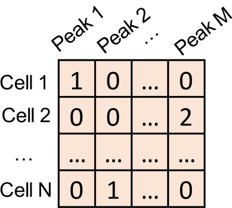{width=40% fig-align="center"}

:::

::: {style="font-size: 30%;"}
[Liu et al., Nat Mach Intel, 2021 ](https://pmc.ncbi.nlm.nih.gov/articles/PMC8223760/figure/F1/){target="_blank"}
:::


:::

::: {.column width="50%"}

```{=html}
<pre class="tree">
outs/
├── analysis
├── cloupe.cloupe
├── cut_sites.bigwig
├── filtered_peak_bc_matrix/
├── <mark>filtered_peak_bc_matrix.h5</mark>
├── filtered_tf_bc_matrix/
├── filtered_tf_bc_matrix.h5
├── fragments.tsv.gz
├── fragments.tsv.gz.tbi
├── peak_annotation.tsv
├── peak_motif_mapping.bed
├── peaks.bed
├── possorted_bam.bam
├── possorted_bam.bam.bai
├── raw_peak_bc_matrix/
├── raw_peak_bc_matrix.h5
├── singlecell.csv
├── summary.csv
├── summary.json
└── web_summary.html
</pre>
```
:::

:::

## Output files - Cell metadata


::: {.columns}

::: {.column width="50%"}

::: {style="font-size: 80%;"}
- [**fragments.tsv.gz/fragments.tsv.gz.tbi**: location of each fragment]{style="color: grey;"}
- [**filtered_peak_bc_matrix.h5**: count matrix with peaks as the rows and the cell barcodes as the columns]{style="color: grey;"}
- **singlecell.csv** contains metadata per barcode (TSS_fragments, mitochondrial fragments, etc.)

:::

:::

::: {.column width="50%"}

```{=html}
<pre class="tree">
outs/
├── analysis
├── cloupe.cloupe
├── cut_sites.bigwig
├── filtered_peak_bc_matrix/
├── filtered_peak_bc_matrix.h5
├── filtered_tf_bc_matrix/
├── filtered_tf_bc_matrix.h5
├── fragments.tsv.gz
├── fragments.tsv.gz.tbi
├── peak_annotation.tsv
├── peak_motif_mapping.bed
├── peaks.bed
├── possorted_bam.bam
├── possorted_bam.bam.bai
├── raw_peak_bc_matrix/
├── raw_peak_bc_matrix.h5
├── <mark>singlecell.csv</mark>
├── summary.csv
├── summary.json
└── web_summary.html
</pre>
```
:::

:::


## Output files - Cloupe file


::: {.columns}

::: {.column width="50%"}

::: {style="font-size: 80%;"}
- [**fragments.tsv.gz/fragments.tsv.gz.tbi**: location of each fragment]{style="color: grey;"}
- [**filtered_peak_bc_matrix.h5**: count matrix with peaks as the rows and the cell barcodes as the columns]{style="color: grey;"}
- [**singlecell.csv** contains metadata per barcode (TSS_fragments, mitochondrial fragments, etc.)]{style="color: grey;"}
- **cloupe.cloupe**: allows for quick visualization within the [10X Loupe browser software](https://www.10xgenomics.com/support/software/loupe-browser/latest){target="_blank"}
:::

:::

::: {.column width="50%"}

```{=html}
<pre class="tree">
outs/
├── analysis
├── <mark>cloupe.cloupe</mark>
├── cut_sites.bigwig
├── filtered_peak_bc_matrix/
├── filtered_peak_bc_matrix.h5
├── filtered_tf_bc_matrix/
├── filtered_tf_bc_matrix.h5
├── fragments.tsv.gz
├── fragments.tsv.gz.tbi
├── peak_annotation.tsv
├── peak_motif_mapping.bed
├── peaks.bed
├── possorted_bam.bam
├── possorted_bam.bam.bai
├── raw_peak_bc_matrix/
├── raw_peak_bc_matrix.h5
├── singlecell.csv
├── summary.csv
├── summary.json
└── web_summary.html
</pre>
```
:::

:::

## Output files - Web summary


::: {.columns}

::: {.column width="50%"}

::: {style="font-size: 80%;"}
- [**fragments.tsv.gz/fragments.tsv.gz.tbi**: location of each fragment]{style="color: grey;"}
- [**filtered_peak_bc_matrix.h5**: count matrix with peaks as the rows and the cell barcodes as the columns]{style="color: grey;"}
- [**singlecell.csv** contains metadata per barcode (TSS_fragments, mitochondrial fragments, etc.)]{style="color: grey;"}
- [**cloupe.cloupe**: allows for quick visualization within the [10X Loupe browser software](https://www.10xgenomics.com/support/software/loupe-browser/latest){target="_blank"}]{style="color: grey;"}
- **web_summary.html**: QC summary that is often your first look at data quality
  + very important output and the focus of the next section
:::

:::

::: {.column width="50%"}

```{=html}
<pre class="tree">
outs/
├── analysis
├── cloupe.cloupe
├── cut_sites.bigwig
├── filtered_peak_bc_matrix/
├── filtered_peak_bc_matrix.h5
├── filtered_tf_bc_matrix/
├── filtered_tf_bc_matrix.h5
├── fragments.tsv.gz
├── fragments.tsv.gz.tbi
├── peak_annotation.tsv
├── peak_motif_mapping.bed
├── peaks.bed
├── possorted_bam.bam
├── possorted_bam.bam.bai
├── raw_peak_bc_matrix/
├── raw_peak_bc_matrix.h5
├── singlecell.csv
├── summary.csv
├── summary.json
└── <mark>web_summary.html</mark>
</pre>
```
:::

:::

## Output files - MEX format files

::: {.columns}

::: {.column width="50%"}

::: {style="font-size: 80%;"}
The **filtered_peak_bc_matrix/** folder contains the same peak × cell matrix as the .h5 file in MEX format: plain text files that can be read without special libraries.

  - matrix.mtx: sparse matrix of non-zero counts
  - peaks.bed: the rows (peaks)
  - barcodes.tsv: the columns (cell barcodes)

While we won't be using them here, you might see these on GEO or elsewhere and these can be read into R/Python for downstream processing. 
:::

:::

::: {.column width="50%"}
```{=html}
<pre class="tree">
outs/
├── analysis
├── cloupe.cloupe
├── cut_sites.bigwig
├── <mark>filtered_peak_bc_matrix/</mark>
├── filtered_peak_bc_matrix.h5
├── filtered_tf_bc_matrix/
├── filtered_tf_bc_matrix.h5
├── fragments.tsv.gz
├── fragments.tsv.gz.tbi
├── peak_annotation.tsv
├── peak_motif_mapping.bed
├── peaks.bed
├── possorted_bam.bam
├── possorted_bam.bam.bai
├── raw_peak_bc_matrix/
├── raw_peak_bc_matrix.h5
├── singlecell.csv
├── summary.csv
├── summary.json
└── web_summary.html
</pre>
```
:::

:::


# Cell Ranger Web Summary {background-color="#23373B" .center .middle}


## QC is essential

::: {.columns}

::: {.column width="50%"}

::: {style="font-size: 90%;"}
There are many potential issues which can arise in scATAC-seq data including:

- Ambient DNA contamination
- Doublets 
- Low quality cells (dead or dying)
- Empty droplets


:::

:::

::: {.column width="50%"}
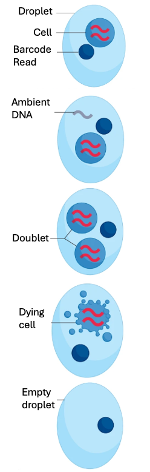{width=37% fig-align="center"}
:::

:::
::: {.absolute bottom="0" left="0" style="font-size: 30%;"}
[Heumos et al., Nat Rev Genetics, 2023 ](https://www.nature.com/articles/s41576-023-00586-w){target="_blank"}
:::


## Metrics and Web Summary

As we saw in the output files, Cell Ranger generates summaries of useful metrics as a text file _(summary.csv)_ and as an intuitive web-page _(web_summary.html)_.

<br> 

While it often takes a deeper look into the results to understand QC issues, the Cell Ranger summary can give our first insight into key issues we might face.

<br>

We will be going through the web summary generated from our [PBMC dataset](https://www.10xgenomics.com/datasets/500-peripheral-blood-mononuclear-cells-pbm-cs-from-a-healthy-donor-next-gem-v-1-1-1-1-standard-2-0-0){target="_blank"}. The web summary is also in the 'data' folder of the course materials [(link to report)](../../data/web_summary_pbmc500.html){target="_blank"}.


## Web Summary overview

::: {.columns}

::: {.column width="50%"}

::: {style="font-size: 80%;"}
The web summary html file contains an interactive report describing the most essential QC for your single cell experiment.
<br>
<br>
It prominently displays warnings at the top to indicate metrics outside the expected ranges.
<br>
<br>
The summary also contains useful information on the input files and the versions used in this analysis for later reproducibility.

[Here's a link](https://cdn.10xgenomics.com/image/upload/v1660261285/support-documents/CG000202_TechnicalNote_InterpretingCellRangerATACWebSummaryFiles_RevB.pdf){target="_blank"} to a useful document from 10x explaining this summary in detail. 
:::

:::

::: {.column width="50%"}
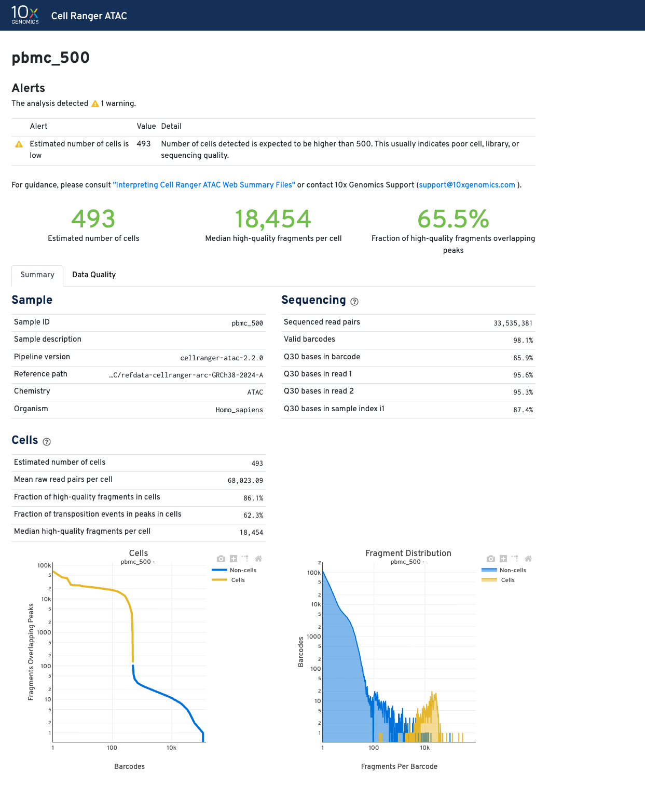{width=100% fig-align="center"}
:::

:::

::: {.absolute bottom="0" left="0" style="font-size: 30%;"}
[link to full summary](../../data/web_summary_pbmc500.html){target="_blank"}
:::

## Sample Summary

The first thing we can review is the **Sample** information panel.
As most people do not run Cell Ranger themselves this is important to check it matches expectations.

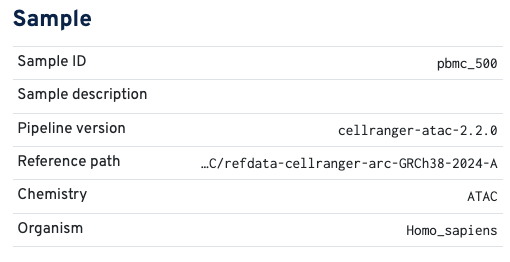{width=40% fig-align="center"}

- Sample ID - Sample name (assigned in **cellranger-atac count**)
- Chemistry - The 10x chemistry used
- Reference path - path on system to pre-built reference file from command
- Pipeline Version - Version of Cell Ranger used


## Sequencing panel

The **Sequencing** panel highlights information on the quality of the Illumina sequencing.

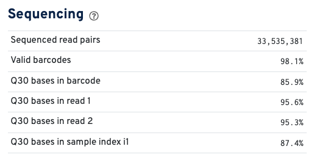{width=40% fig-align="center"}

- Sequenced read pairs - Total read pairs
- Valid barcodes - fraction of read pairs that match an expected 10x barcode from the whitelist (> 75%)
- Q30 bases - percent of bases with Q-score > 30 (>65%)


## Cells panel

::: {style="font-size: 80%;"}
The **Cells** panel highlights some of the most important metrics, including some that are repeated and placed as the headline of the report.

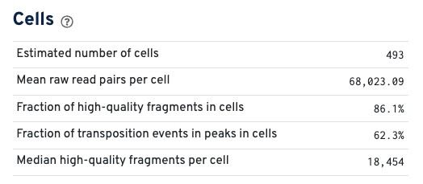{width=40% fig-align="center"}


- Estimated Number of Cells - Total number of barcodes associated to at least one cell (500-10k).
- Mean raw read pairs per cell -  Total sequenced read pairs divided by number of cells
- Fraction of high-quality fragments in cells - fraction of high quality fragments (map to genome, mapQ > 30, no chimeric or duplicate) with a called cell barcode (>40%)
- Fraction of transposition events in peaks in cells - fraction of Tn5 cut sites (fragment ends) from called cell barcodes that fall within a peak (>15%)
- Median fragments per Cell - Median number of fragments per called cell barcode
:::


## Barcode rank (knee) plot 

::: {.columns}

::: {.column width="50%"}

::: {style="font-size: 80%;"}


The **Cells** panel also includes an interactive knee plot:

- On the x-axis, the barcodes ordered by the most frequent on the left to the least frequent on the right
- On the y-axis, the number of fragments that overlap a peak for each barcode.
- Highlighted in yellow are the barcodes marked as associated to cells.

:::
:::

::: {.column width="50%"}
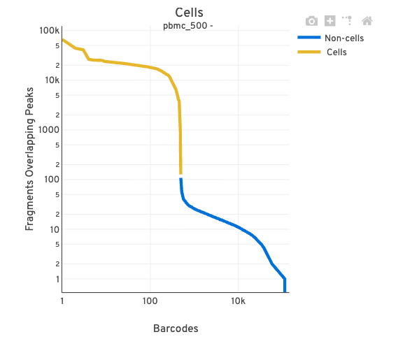

:::

:::

## Barcode rank (knee) plot 

::: {.columns}

::: {.column width="50%"}

::: {style="font-size: 80%;"}


Cell Ranger ATAC uses a two step process to define cell-associated barcodes

- First, problematic barcodes are removed (e.g. one nucleus split across multiple barcodes).
- Second, a model is fitted to separate signal from noise.
- A detailed explanation is [here](https://www.10xgenomics.com/support/software/cell-ranger-atac/latest/algorithms-overview/algorithms-overview#cell-calling-a2c13c){target="_blank"}

If required, a **--force-cells** flag can be used with _cellranger-atac count_ to identify a specific number of cell-associated barcodes.


:::
:::

::: {.column width="50%"}


:::

:::

## Cell vs Non-cell Fragment Distribution  

::: {.columns}

::: {.column width="50%"}

::: {style="font-size: 80%;"}


When looking at the distribution of fragments per barcode, a good QC sample shows a separation between barcodes identified as cells compared to non-cells.

<br>

Our PBMC data is an example of this separation.
:::
:::

::: {.column width="50%"}
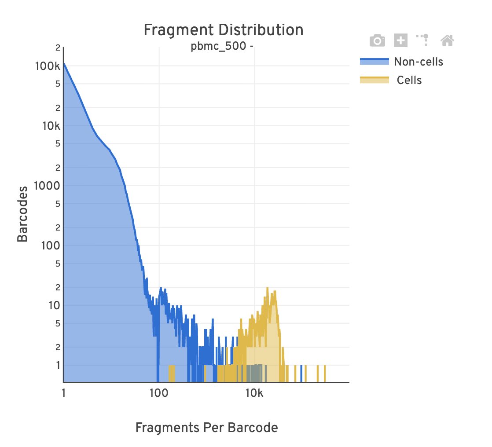

:::

:::

## Poor QC example

The barcode rank plot and fragment distribution also act as good QC tools to investigate differing types of single cell failure.

Whereas our previous barcode rank plot represented a good sample, differing knee plot patterns can be indicative of specific problems with the single cell protocol. 


## Poor QC example

::: {style="font-size: 90%;"}
Commonly a problematic sample will show a gradual, rounded curve around the expected number of cells instead of a steep cliff, and weak separation in the fragment distribution.

This is often indicative of technical problems, such as high ambient tagmented DNA from dying or broken nuclei that is captured by empty droplets or a failure in the integration of oil, beads and samples (wetting failure)  

This is indicated in the plots below: 
:::

::: {.columns}

::: {.column width="50%"}
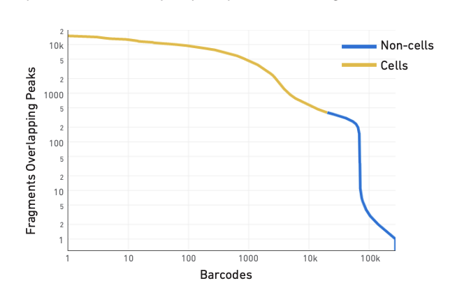
:::

::: {.column width="50%"}
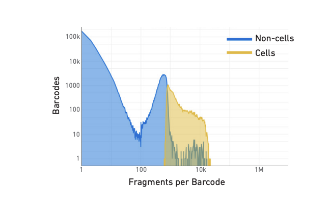
:::

:::

## Cell Clustering Panel

::: {style="font-size: 90%;"}
The **Cell Clustering** panel shows a t-SNE plot with basic clustering of peak counts from valid cell barcodes.

Assuming different cell types are expected, we would hope to see separation between clusters. We will do a more in depth clustering analysis later on, but the lack of any cluster separation here can be an early indication of QC issues. 

We also hope that our clusters aren't driven by the number of fragments in a cell, and this would be seen in the t-SNE on the right. 
:::

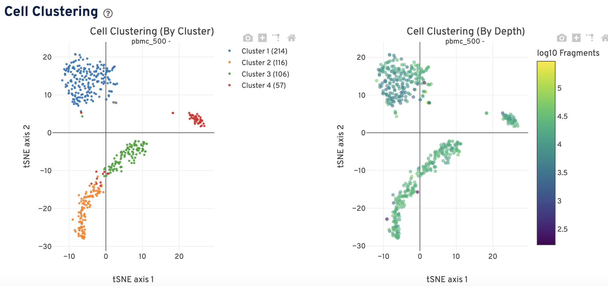{fig-align="center" style="max-width: none; max-height: none; width: 70%;"}

## Library Complexity Panel

The **Library Complexity** panel (in the Data Quality tab) shows the percent duplicates and a saturation curve showing median fragments per cell over successive downsampling of the data. 

With a reasonable number of fragments per cell, we expect the fraction of duplicates to be >30%, indicating a reasonable level of saturation. A lower value here might suggest that deeper sequencing could help. 

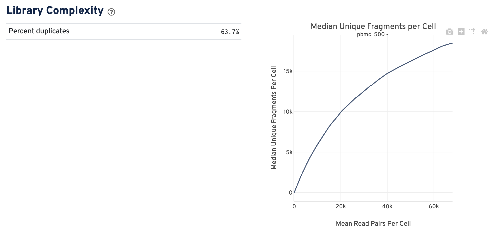{fig-align="center" style="max-width: none; max-height: none; width: 70%;"}

## Mapping Panel

::: {style="font-size: 90%;"}
The **Mapping** panel shows the mapping rate (ideally > 85%) and the percent of unmapped reads (<5%), in addition to a few key ATAC-seq metrics. 

- Fragments in nucleosome-free regions - percent of fragments passing all mapping filters with length < 124 bases (>40%)
- Fragments flanking a single nucleosome - fragments between 124 and 296 bases (i.e. the second bump below). This should be lower than nucleosome-free, but still a meaningful number of reads suggesting good chromatin structure. 
:::

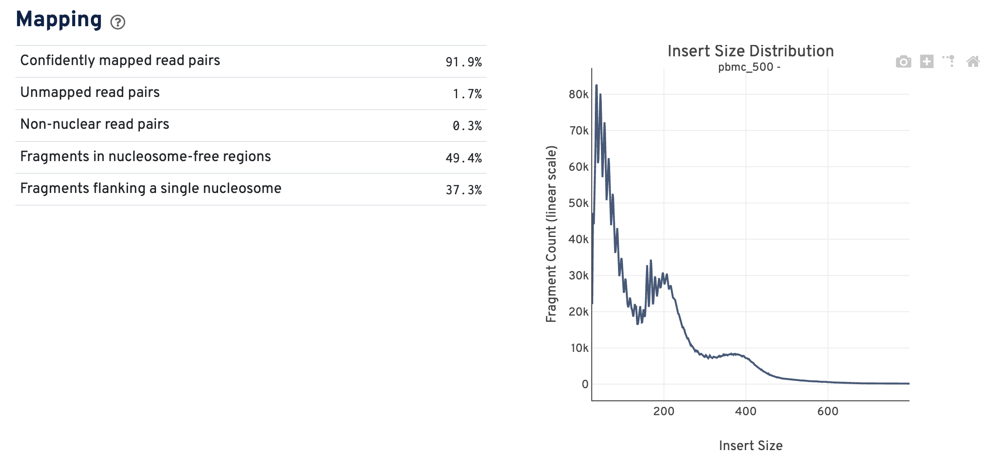{fig-align="center" style="max-width: none; max-height: none; width: 65%;"}


## Targeting Panel

::: {style="font-size: 90%;"}
The **Targeting** panel shows information related to the pile-up of reads across the genome. 

- Cell Ranger ATAC calls peaks with all fragments that have a valid barcode, including those from empty droplets. 
- With the _--peaks_ option on _cellranger-atac count_, a bed file of user-provided peaks can be used as well. 
- We would hope for >45k peaks that cover between 2-20% of the genome. With only 500 cells, our example is a little low, but more cells would likely help here. 

:::

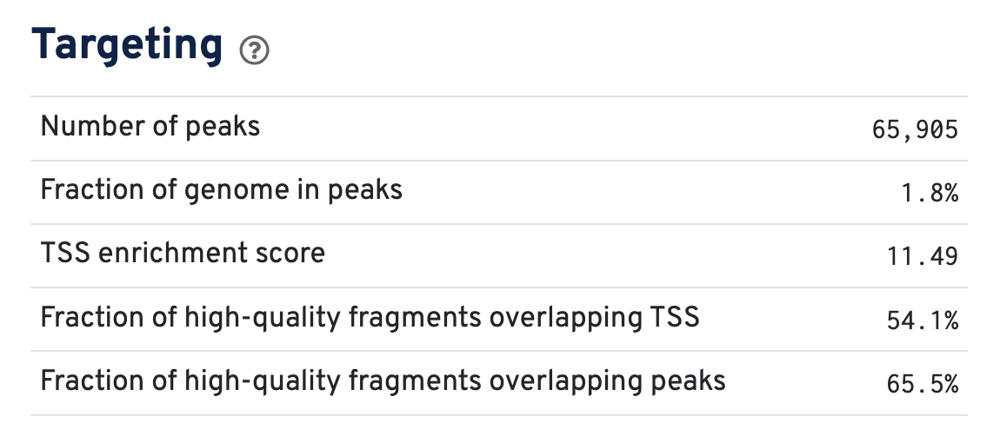{fig-align="center" style="max-width: none; max-height: none; width: 50%;"}

## Targeting Panel

::: {.columns}

::: {.column width="35%"}
::: {style="font-size: 80%;"}
A high quality dataset shows significant enrichment of fragments over TSS and peak regions

Ideally, **TSS enrichment** score would be greater than 5, and the **fraction of fragments overlapping TSS and peaks** would both be above 15%. 

Low numbers here could be a result of ambient DNA/dying cells, or shallow sequencing depth. 


:::
:::

::: {.column width="65%"}
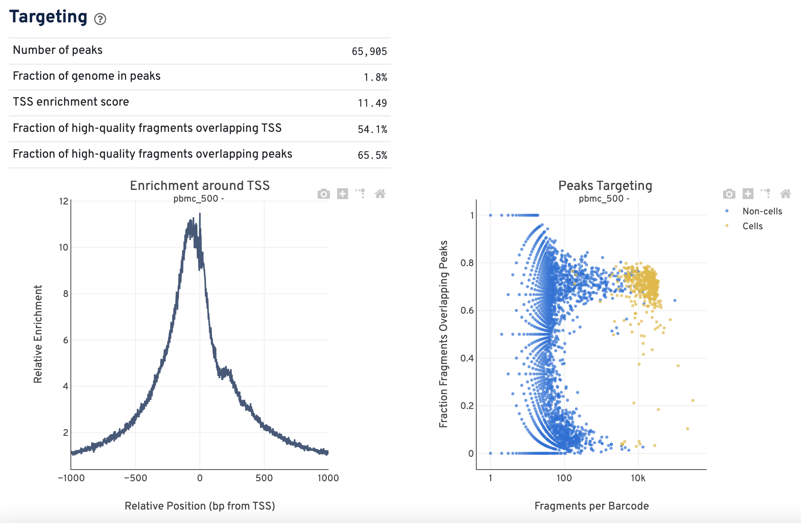
:::

:::

## Poor QC example continued...

::: {style="font-size: 90%;"}
These plots can very quickly indicate QC problems. 

:::
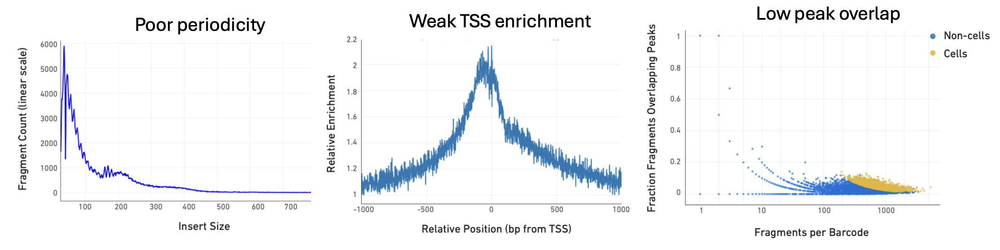{fig-align="center" style="max-width: none; max-height: none; width: 100%;"}

::: {style="font-size: 90%;"}
**It's important to note** that the targets for these QC metrics aren't hard cut-offs. They are meant to highlight potential issues to be aware of and potentially account for during downstream analysis.

Oftentimes we can employ strategies to get meaningful insights from problematic data.
:::


## Next steps

Fingers crossed there are no QC issues. 

Often at this step we wouldn't make any decisions unless there is a clear complete failure. This is an important first step in setting expectations/preparing for what you may need to do for the dataset.

Next we will read the data into R and into a format that we can interrogate further.

# Reading data into R with Signac {background-color="#23373B" .center .middle}

## Signac for Downstream Analysis

Here we will use [Signac](https://stuartlab.org/signac/){target="_blank"}, which is an R software package that facilitates most of the downstream processing steps.

Signac is an extension of the well-supported Seurat ecosystem used for scRNA-seq and integrates easily with multiome (RNA + ATAC) analysis. 

::: {.absolute bottom="0" left="0" style="font-size: 30%;"}
[Stuart et al., Nat Methods, 2021 ](https://www.nature.com/articles/s41592-021-01282-5){target="_blank"}
:::

## Software Options for Downstream Analysis

Other popular options include:

- [ArchR](https://www.archrproject.com/){target="_blank"} (R package)
- [SnapATAC2](https://snapatac2.scverse.org/){target="_blank"} (Python package)

Both have advantages handling large data compared to Signac.

<br>

**Importantly**, the QC concepts and decision points that we will discuss today will be similar no matter which software you choose.  

::: {.absolute bottom="0" left="0" style="font-size: 30%;"}
[Granja et al., Nat Genetics, 2021 ](https://www.nature.com/articles/s41588-021-00790-6){target="_blank"}
<br>
[Zhang et al., Nat Methods, 2024 ](https://www.nature.com/articles/s41592-023-02139-9){target="_blank"}
:::


## Reading data into Signac

::: {.columns}

::: {.column width="50%"}

::: {style="font-size: 80%;"}

Let's remember what outputs we have from Cell Ranger ATAC

The key files we will need are:

- **fragments.tsv.gz**: location of each fragment
- **filtered_peak_bc_matrix.h5**: per-cell counts over peaks called on pooled fragments
- **singlecell.csv**: cell metadata

:::

:::

::: {.column width="50%"}

```{=html}
<pre class="tree">
outs/
├── analysis
├── cloupe.cloupe
├── cut_sites.bigwig
├── filtered_peak_bc_matrix/
├── <mark>filtered_peak_bc_matrix.h5</mark>
├── filtered_tf_bc_matrix/
├── filtered_tf_bc_matrix.h5
├── <mark>fragments.tsv.gz</mark>
├── <mark>fragments.tsv.gz.tbi</mark>
├── peak_annotation.tsv
├── peak_motif_mapping.bed
├── peaks.bed
├── possorted_bam.bam
├── possorted_bam.bam.bai
├── raw_peak_bc_matrix/
├── raw_peak_bc_matrix.h5
├── <mark>singlecell.csv</mark>
├── summary.csv
├── summary.json
└── web_summary.html
</pre>
```
:::

:::


## Reading data into Signac

With these files we can build the Seurat object that will contain our Cell Ranger data and be used for downstream analysis. 

First, we load the Signac and Seurat libraries. 
```{r}
library(Signac)
library(Seurat)

```

## Reading into Signac - Metadata

The *singlecell.csv* file is then read in as a dataframe that has the barcodes as rows and metadata categories as columns. 

This dataframe has metadata for all barcodes (not just called cells) and a 'NO_BARCODE' row showing the number of read pairs with no associated barcode. 
```{r,echo=T}
metadata <- read.csv(
  file = "data/pbmc500_singlecell.csv",
  header = TRUE,
  row.names = 1
)
metadata[1:3, 1:4]

```


## Reading into Signac - Peak counts

The *filtered_peak_bc_matrix.h5* file contains the peak counts per cell, and we read it in with the Seurat *Read10X_h5* function. While not completely necessary, here we will subset to the standard chromosomes.

This creates a sparse matrix object with the peak counts.

```{r,echo=T}
counts <- Read10X_h5(filename = "data/pbmc500_filtered_peak_bc_matrix.h5")
std_chr   <- paste0("chr", c(1:22, "X", "Y"))
peak_chr  <- as.character(seqnames(StringToGRanges(rownames(counts), sep = c(":", "-"))))
counts    <- counts[peak_chr %in% std_chr, ]
counts[1:5, 1:2]
```

## Reading into Signac - ChromatinAssay object

The counts and a path to the fragments file are provided to the *CreateChromatinAssay* function from Signac to create a **ChromatinAssay** object.

We can set the 'min.cells' and 'min.features' arguments to filter out low quality peaks and cells. 

```{r,echo=F, eval=T}
pbmc <- readRDS("data/pbmc_start.rds")
```

```{r,echo=T, eval=F}
chrom_assay <- CreateChromatinAssay(
  counts = counts,
  sep = c(":", "-"),
  fragments = "data/pbmc500_fragments.tsv.gz",
  min.cells = 10,
  min.features = 200
)

class(chrom_assay)
```

```{r,echo=F, eval=T}
class(pbmc@assays$peaks)
```


## Create Seurat object

Finally, the ChromatinAssay object and the metadata dataframe are used to create a Seurat object with an assay called 'peaks' that contains our peak counts. 

Only metadata from the cells in the *chrom_assay* object will be carried into the Seurat object. 

```{r,echo=T, eval=F}
pbmc <- CreateSeuratObject(
  counts = chrom_assay,
  assay = "peaks",
  meta.data = metadata
)

pbmc
```

```{r,echo=F, eval=T}
pbmc
```

## Seurat object for scATAC/Signac

This Seurat object can be handled like any other, with a few additional pieces of information specific to scATAC-seq.

Seurat object accessor functions will work as expected: 
```{r,echo=T, eval=T}
Assays(pbmc)
DefaultAssay(pbmc)
Layers(pbmc)
```

## Seurat object for scATAC/Signac

There are functions to access pieces of the ChromatinAssay object, where much of the scATAC-specific information is kept. Detailed information on this data structure and how to interact with it can be found [here](https://stuartlab.org/signac/articles/data_structures){target="_blank"}. 

For example, our peak ranges can be pulled out with the *granges* function. 
```{r,echo=T, eval=T}
Signac::granges(pbmc)
```

## Fragment information 

The individual fragment information is not kept in memory within the Seurat object, but the *Fragments* function returns a list of **Fragment** objects that contain key information, including the following:

- the path to the fragment file
- an md5 hashes of the fragment file and index
- the cell barcodes associated with these fragments

These can be accessed with the *GetFragmentData* function.

```{r,echo=T, eval=T}
frags <- Fragments(pbmc)  

GetFragmentData(frags[[1]], "path")
```

## Updating the fragments path 

Importantly, there is a pointer to the file path we provided, and if the fragment file has moved we would need to update that pointer with the *UpdatePath* function. 

Any function that requires access to the actual fragments will fail if the pointer is wrong (TSS enrichment, peak calling). 

You can download the **fragments file and the index** used in this course and update the path to align your object with your system ([link to dataset files](https://www.10xgenomics.com/datasets/500-peripheral-blood-mononuclear-cells-pbm-cs-from-a-healthy-donor-next-gem-v-1-1-1-1-standard-2-0-0){target="_blank"}).    

```{r,echo=T, eval=F}
frags_updated <- UpdatePath(
  frags[[1]],
  new.path = "~/Downloads/atac_pbmc_500_nextgem_fragments.tsv.gz"
)
Fragments(pbmc) <- NULL
Fragments(pbmc) <- frags_updated

```

## Updating the fragments path 

The fragment object contains the md5 hash of the file, so if the file at the new path isn't identical to the original, you will get an error. 
```{r, echo=T, eval=F}
frags_updated_bad <- UpdatePath(
  frags[[1]],
  new.path = "~/Downloads/different_pbmc500_fragments.tsv.gz"
)
```

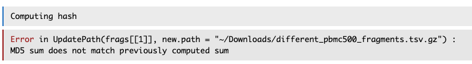{.nostretch fig-align="left" width="80%"}

## Time for an exercise!

There are a few exercises to gain some familiarity with the Signac object [here](../../exercises/exercises/Session1_Exercise_exercise.html){target="_blank"}

## Answers to exercise

Answers can be found [here](../../exercises/answers/Session1_Exercise_answers.html){target="_blank"}


