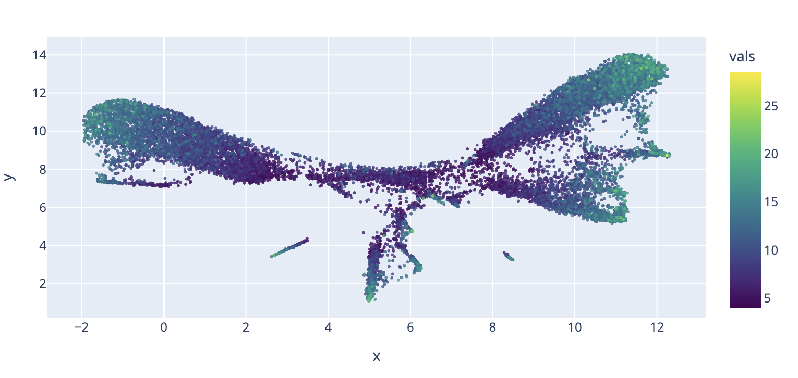
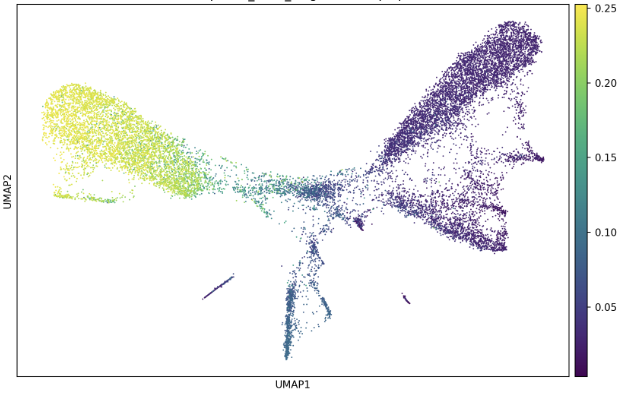

```{r setup, include=FALSE, purl=FALSE}
suppressPackageStartupMessages(require(knitr))
knitr::opts_chunk$set(echo = TRUE, tidy = FALSE)
```

::: {.content-hidden when-format="revealjs"}
# Single-cell ATAC-seq: Dimensionality Reduction and Clustering
:::

## Recap

Thus far we have covered:

- Cell Ranger 
- Importing data into R and Signac
- Generating QC metrics
- Deciding on cutoffs
- Normalization and feature selection

## Overview

- [Latent Semantic Indexing](#latent-semantic-indexing)
- [UMAP embedding](#umap-embedding)
- [Graph-based clustering](#graph-based-clustering)
- [Re-calling peaks](#re-calling-peaks)
- [Revisiting QC](#qc-revisited)
- [Gene activity scores](#gene-activity-scores)
- [Label transfer from scRNA-seq](#label-transfer-from-scrna-seq)


# Latent Semantic Indexing {background-color="#23373B" .center .middle}

## Latent Semantic Indexing

LSI = TF-IDF followed by singular value decomposition (SVD). 

Just as a reminder scATAC has a specific data structure that makes conventional scRNAseq methods problematic. 

Thus far we have done TF-IDF which normalizes for per-cell sequencing depth (TF) and up-weights rarer, more informative peaks (IDF).

The next step is SVD. This in place of PCA for scRNAseq.

## Why Can't We Use PCA?

In scRNA-seq, **PCA** is the standard dimensionality reduction step applied after normalization.

For scATAC-seq, the TF-IDF matrix is:

- **Non-negative** — values range from 0 upwards
- **Sparse** — most entries are 0
- **High-dimensional** — up to ~100,000 peaks

PCA applied directly to TF-IDF data performs poorly because PCA assumes approximately Gaussian-distributed inputs and is sensitive to the distribution of zeros.

## What is SVD doing?

Like PCA, SVD summarizes ~100,000 peaks as a few dozen **"accessibility programs"**:
groups of peaks that tend to open and close together across cells
(e.g. a set of T-cell enhancers). The top dimensions capture the major axes of chromatin accessibility variation across cells — analogous to principal components.

## What is SVD doing?

It splits the TF-IDF matrix into three parts:

| Part | Plain meaning |
|---|---|
| **U** | Which peaks make up each program |
| **Σ** | How much variation each program explains |
| **V** | How much of each program each cell has |

We keep **V**: each cell becomes ~50 numbers (one per program) instead of
~100,000 peaks. These are the **LSI components** we use for UMAP and clustering.

For more details on [SVD](https://www.pnas.org/doi/10.1073/pnas.97.18.10101), there is a good explainer for when it was first applied to genomics for microarrays. 

## Running SVD in Signac

Lets start by loading in the object as we left it (or continue from where you were in the session).

```{r runSVD}
library(Signac)
library(Seurat)
library(ggplot2)

pbmc <- readRDS("data/pbmc_filtered_tfidf.rds")

pbmc <- RunSVD(pbmc)

pbmc[["lsi"]]

```

```{r repointFragments, include=FALSE, purl=FALSE}
# The saved object records the fragment file's absolute path on the machine that
# built it. When a copy sits in data/ (CI downloads it there), point the object
# at that copy so fragment-based steps (GeneActivity) can find it; otherwise keep
# the recorded path.
frag_local <- "data/atac_pbmc_500_nextgem_fragments.tsv.gz"
if (file.exists(frag_local)) {
  frags <- UpdatePath(Fragments(pbmc)[[1]], new.path = frag_local)
  Fragments(pbmc) <- NULL
  Fragments(pbmc) <- frags
}
```

## SVD dimensions

`RunSVD()` defaults to 50 dimensions.

* The **first singular vector** in LSI is almost always strongly correlated with total fragment count (sequencing depth) rather than meaningful biological variation. This is because cells with high reads tend to have fewer non-zero entries across all peaks.
* You rarely need all 50 for clustering. 

Dimensions 2–30 are a common working set, but we can always check `DepthCor()` first.

```{r depth_cor, eval=FALSE}
DepthCor(pbmc)
```

## Inspecting DepthCor Output

The output is a bar plot showing the Pearson correlation of each LSI component with `log10(nCount_peaks)`.

```{r depthCor}
DepthCor(pbmc)
```


## What to look for
- **LSI 1:** correlation close to +/-1 → **always exclude**
- **Later components:** correlations > 0.75 → may also be depth-driven; consider excluding
- **Most datasets:** skip LSI 1, use 2–30

::: {.callout-important}
Downstream calls that use LSI must specify `dims = 2:N` explicitly.
:::


# UMAP Embedding {background-color="#23373B" .center .middle}

## From LSI to UMAP

::: {.columns}

::: {.column width="50%"}
**UMAP** projects the high-dimensional LSI space into 2D for visualization. It's preferred to t-SNE generally:

- Preserves more **global structure** (relative position of clusters matters)
- Runs faster on large datasets
- Is more reproducible with a fixed seed

We set `seed.use = 42` for reproducibility.
:::

::: {.column width="50%"}
```{r runUMAP}
pbmc <- RunUMAP(
  object    = pbmc,
  reduction = "lsi",
  dims      = 2:30,
  seed.use  = 42
)

DimPlot(object = pbmc, label = TRUE) + NoLegend()
```
:::

:::

## Interpreting the UMAP

Cells cluster together based on **similarity of their chromatin accessibility profiles**.

Different cell types have distinct combinations of accessible regulatory elements and should separate in UMAP space.


## Common UMAP pitfalls: depth gradients

Run this check before trusting the UMAP:
```{r}
pbmc2 <- RunUMAP(
  object    = pbmc,
  reduction = "lsi",
  dims      = 1:30,
  seed.use  = 42
)

FeaturePlot(pbmc2, features = "nCount_peaks", max.cutoff = "q95")
```

If you see a smooth gradient of fragment count across the UMAP, LSI component 1 may have been included. Re-run `RunUMAP()` excluding it.

# Graph-Based Clustering {background-color="#23373B" .center .middle}

## Clustering with Seurat

The clustering workflow mirrors scRNA-seq:

1. **Build a k-nearest neighbor (KNN) graph** in LSI space
2. **Refine with SNN** (shared nearest neighbor)
3. **Community detection** — Louvain, SLM or Leiden algorithm

Leiden is considered the gold standard these days, but you also need to install the [leiden algorithm outside of R](https://leidenalg.readthedocs.io/en/stable/intro.html). In the Signac vignette they use SLM, so lets go for that for now.

## Clustering with Seurat

```{r findClusters}
pbmc <- FindNeighbors(
  object    = pbmc,
  reduction = "lsi",
  dims      = 2:30
)

pbmc <- FindClusters(
  object    = pbmc,
  verbose   = FALSE,
  algorithm = 3,
  random.seed = 42
)
```

## Clustering with Seurat

```{r}
DimPlot(object = pbmc, label = TRUE) + NoLegend()
```

## Tuning the Resolution Parameter

There is no single "correct" resolution. The right level of granularity depends on your biological question — coarser for broad lineages, finer for rare subtypes. Try several values and compare cluster stability.

```{r resolutionTuning, warning=F, message=F}
pbmc <- FindClusters(pbmc, resolution = 0.5)   # coarser
pbmc <- FindClusters(pbmc, resolution = 2.0)   # finer

p1 <- DimPlot(pbmc, group.by = "peaks_snn_res.0.5", label = TRUE) +
      ggtitle("Resolution 0.5") + NoLegend()
p2 <- DimPlot(pbmc, group.by = "peaks_snn_res.2",   label = TRUE) +
      ggtitle("Resolution 2.0") + NoLegend()
```

## Tuning the Resolution Parameter

```{r}

p1 + p2
```

## Tuning the Resolution Parameter

On the first pass we will often just go with clusters that are relatively fine and separate QC metrics, markers and annotations effectively. 

Once you have settled on your final object we will do a more thorough clustering optimization, by reviewing clustering stability and again reviewing the data at multiple resolutions. We review how to do this in our [scRNAseq Bootcamp](https://rockefelleruniversity.github.io/SingleCell_Bootcamp/presentations/singlepage/Session2.html#Clustering)

# QC Revisited {background-color="#23373B" .center .middle}

## QC is Iterative, Not a Single Step

It is good practice to **re-examine QC metrics in the context of your clusters** after embedding.

Low-quality cells may form isolated clusters or cluster with real cell types but with distinctly worse metrics.

```{r qcOnUMAP1}
FeaturePlot(
  object     = pbmc,
  features   = c("nCount_peaks",
    "TSS.enrichment",
    "excl_prop",
    "nucleosome_signal"),
  ncol       = 2,
  max.cutoff = "q95",
  pt.size = 0.2
)
```

## QC is Iterative, Not a Single Step

```{r qcOnUMAP2}
FeaturePlot(
  object     = pbmc,
  features   = c(
    "pct_reads_in_peaks",
    "amulet.q",
    "scDblFinder.score"),
  ncol       = 2,
  max.cutoff = "q95",
  pt.size = 0.2
)
```

## QC is Iterative, Not a Single Step

Violin plots split by cluster can also help discern differences. 

```{r qcOnVlnPlot}
VlnPlot(
  object     = pbmc,
  features   = c("nCount_peaks",
    "TSS.enrichment",
    "excl_prop",
    "nucleosome_signal",
    "pct_reads_in_peaks",
    "scDblFinder.score",
    "amulet.q"),
  split.by = "peaks_snn_res.2",
  ncol       = 3
)
```

## Revisiting doublets and other artefacts

**Doublets** often appear between major clusters in the UMAP.

Signs of a doublet cluster:

- Intermediate accessibility profile
- Higher fragment count than neighboring clusters
- Enriched for markers of two different cell types

## Cyclical QC strategy

Let's remember: 

1. Apply conservative thresholds initially
2. UMAP and Cluster
3. Double-check QC metrics on UMAP to see if anything is sticking out
4. Update filters or remove suspect clusters. Go back to 2, until there are no remaining QC concerns. 

Two to three iterations is common before settling on a final cell set.

## Example: TSSE

In this case we have a dataset we worked on with the TSSE score mapped on the UMAP. We can see a clear regional changes in the score across the UMAP. Though a TSSE of 5 is really good, the context matters. 

This could either indicate a heterogeneous tagmentation across cell types or clustering of poor quality cells. In this case we saw multiple QC metrics and a mixture of marker genes enriched in this area. This indicated we would need to subcluster and repeat.




## Our data?

We can see some clear separation of some QC metrics across the UMAP. 

There are low counts in one cluster. But the other metrics look pretty okay. 

QC does not have to end here though. We will keep an eye on that cluster as we do check for marker peaks and do cell type annotation. 

# Re-calling Peaks {background-color="#23373B" .center .middle}

## Why re-call peaks?

So far we have used the peaks Cell Ranger called. Cell Ranger calls peaks on **all cells pooled together**, which has some drawbacks:

- The pooled signal is dominated by the **most abundant cell types**. Peaks that are only open in a rare population may never reach significance.
- Peak boundaries reflect the majority population, so a rare cell type's peak may be merged into, or offset from, a neighboring common peak.

Now that we have clusters, we can call peaks **separately for each group of cells** and pick up peaks that are specific to smaller populations. This is why peak re-calling comes *after* dimensionality reduction and clustering: we need the groups first.

::: {.callout-note}
We will not run this section in class. Peak calling typically uses MACS and calling peaks for every cluster takes time. The code is here so you can apply it to your own data.
:::

## MACS

MACS is a tried and trusted peak caller that has been used for various epigenomic methods across bulk and single cell for many years. 

To install it you can simply use miniconda/minimamba. We have a package called Herper to do this all through R. You can use this to install MACS in existing miniconda installs, or to generate a new miniconda. 

```{r, eval=F}
library(Herper)

install_CondaTools("macs","peak.calling", pathToMiniConda = "~/Documents/mini")

```

## Calling peaks per group with MACS

Signac's `CallPeaks()` runs MACS on the fragments from each group of cells and returns a GRanges of peaks.

- **`group.by`** sets the groups, e.g. clusters or transferred cell type labels.
- **`macs2.path`** points to the MACS executable. MACS2 is no longer maintained; MACS3 keeps the same `callpeak` command, so you can pass the path to `macs3` here.
- **`effective.genome.size`** is the mappable genome size. The default (2.7e9) is for human.

```{r callPeaks, eval=FALSE}
peaks <- CallPeaks(
  object                = pbmc,
  group.by              = "seurat_clusters",
  macs2.path            = "~/Documents/mini/env/peak.calling/macs3",
  effective.genome.size = 2.7e9,
  combine.peaks         = TRUE
)
```

## Cleaning up the new peaks

The same filters we applied to the Cell Ranger peaks apply here: keep the standard chromosomes and remove peaks overlapping the blacklist.

```{r filterPeaks, eval=FALSE}
peaks <- keepStandardChromosomes(peaks, pruning.mode = "coarse")
peaks <- subsetByOverlaps(peaks, blacklist_hg38_unified, invert = TRUE)
```

## Building a consensus peak set

Calling peaks per group gives one peak set per group. They overlap but do not line up exactly: the same element can have slightly different boundaries in each group.

A **consensus peak set** merges these into one set of non-overlapping regions, so every group is counted against the same features.

- With `combine.peaks = TRUE`, `CallPeaks()` does this for you: overlapping peaks from different groups are merged (`GenomicRanges::reduce()`).
- The `peak_called_in` column records which groups each consensus peak was found in. Peaks found in only one small cluster are your candidate cell-type-specific elements.

```{r consensusPeaks, eval=FALSE}
head(peaks$peak_called_in)
```

## Consensus peaks across samples

The same problem appears when **combining samples**. Cell Ranger calls peaks for each sample separately, so their peak sets do not match and their count matrices cannot simply be merged.

The fix is the same idea: merge the peak sets, then re-count every sample against the merged set. Very wide merged regions are usually several elements joined together, and very narrow ones are unreliable, so these are often filtered out.

```{r consensusSamples, eval=FALSE}
combined_peaks <- reduce(c(peaks_sample1, peaks_sample2))

peak_widths    <- width(combined_peaks)
combined_peaks <- combined_peaks[peak_widths > 20 & peak_widths < 10000]
```

## The problem with merging: daisy-chaining

Most of the time this approach works well, but sometimes it has a hidden flaw: daisy chaining. `reduce()` joins **any** overlapping peaks. With many groups or samples, peaks that each overlap the next can chain together into one wide region that covers several distinct regulatory elements.

- A strong T-cell peak and a neighboring monocyte peak become one feature, so the cell-type difference between them is averaged away.
- The more groups you merge, the wider these chains get. The width filter above only removes the most extreme cases.

## Iterative overlap removal

An alternative is to keep peaks **separate** and resolve overlaps by significance. This is the approach ArchR uses (Corces *et al.* 2018 *Science*; Granja *et al.* 2021 *Nat Genet*):

1. Make every peak the **same width** (501 bp) around its summit, the point of highest signal.
2. Rank all peaks by significance. Normalize scores within each group first, because deeper groups give larger MACS scores.
3. Keep the most significant peak and **remove** any peak overlapping it. Repeat down the list.

Every element keeps its own peak, and the result is a set of fixed-width, non-overlapping peaks. If you see a lot of large peaks filtered out or in your final peak set, then have a look into this method for making a consensus.

## Counting fragments in the new peaks

New peaks need a new count matrix. `FeatureMatrix()` counts each cell's fragments in each peak directly from the fragment file, so no re-alignment is needed. We store the result as a new assay alongside the original peaks.

```{r newPeakAssay, eval=FALSE}
macs_counts <- FeatureMatrix(
  fragments = Fragments(pbmc),
  features  = peaks,
  cells     = colnames(pbmc)
)

pbmc[["macs_peaks"]] <- CreateChromatinAssay(
  counts     = macs_counts,
  fragments  = Fragments(pbmc),
  annotation = Annotation(pbmc)
)
```

## Then repeat the workflow

The new assay goes back through the same steps: normalization, feature selection, LSI, UMAP and clustering. Compare the new clusters with the old ones. Rare populations that were blurred before may now separate.

```{r rerunOnNewPeaks, eval=FALSE}
DefaultAssay(pbmc) <- "macs_peaks"

pbmc <- RunTFIDF(pbmc)
pbmc <- FindTopFeatures(pbmc, min.cutoff = "q5")
pbmc <- RunSVD(pbmc)
pbmc <- RunUMAP(pbmc, reduction = "lsi", dims = 2:30, seed.use = 42)
```

## Things to consider

- **Small clusters have few fragments.** MACS needs enough signal, so very small groups may return few or no peaks. Merging related small clusters before calling can help.
- **Groups decide what you find.** Peaks are only as specific as the groups you call them in. Calling per cluster at a coarse resolution will still miss subtype-specific peaks.
- **It is iterative.** Better peaks can give better clusters, which can give better peaks. One round is usually enough.
- **It is optional.** For well-separated, abundant cell types like most PBMCs, the Cell Ranger peaks are often sufficient. Re-calling matters most for rare populations and when combining samples.


# Gene activity scores {background-color="#23373B" .center .middle}

## From Peaks to Genes

We have information about our clusters relating to their QC, but assigning cell type labels will also be informative. Clear cell type identities will indicate pure population. To be able to do this we use a proxy for gene expression: `GeneActivity()`.

**Idea:** sum the ATAC-seq fragment counts overlapping a window around each gene's body and promoter.


::: {.callout-note}
This is a **proxy** for expression, not true RNA. Accessible chromatin at a gene promoter or body correlates with transcription but does not equal it, especially for genes regulated primarily by distal enhancers. Typically fragments that overlap 2kb upstream of TSS or anywhere on the gene body are counted. 
:::

## Computing Gene Activity

We generate gene activity scores and add them to our Signac object as a separate assay. We will largely treat this like RNA data. This is a similar approach to generating a multiomic dataset.

GeneActivity() will recount in the context of genes, instead of peaks. This means we will be using the fragments file for this.

```{r geneActivity}
gene.activities <- GeneActivity(pbmc)

pbmc[["RNA"]] <- CreateAssayObject(counts = gene.activities)

pbmc <- NormalizeData(
  object             = pbmc,
  assay              = "RNA",
  normalization.method = "LogNormalize",
  scale.factor       = median(pbmc$nCount_RNA)
)

DefaultAssay(pbmc) <- "RNA"
```

## Using Gene Activity for Annotation

```{r geneActivityViz, echo=T, eval=F}
FeaturePlot(
  object     = pbmc,
  features   = c(
    "MS4A1",   # B cells
    "CD3D",    # T cells
    "LEF1",    # naive T cells
    "NKG7",    # NK cells
    "TREM1",   # monocytes
    "LYZ"      # monocytes/DCs
  ),
  pt.size    = 0.1,
  max.cutoff = "q95",
  ncol       = 3
)
```


## Using Gene Activity for Annotation

```{r geneActivityViz2, eval=T, echo=F}
FeaturePlot(
  object     = pbmc,
  features   = c(
    "MS4A1",   # B cells
    "CD3D",    # T cells
    "LEF1",    # naive T cells
    "NKG7",    # NK cells
    "TREM1",   # monocytes
    "LYZ"      # monocytes/DCs
  ),
  pt.size    = 0.1,
  max.cutoff = "q95",
  ncol       = 3
)
```

## Strengths and Limitations of Gene Activity

### Strengths
- Quick, no additional data required
- Works for well-studied cell types with known marker genes
- Provides biologically interpretable axes for initial annotation
- Scales to large datasets (computed from the fragment file directly)

### Limitations
- Not true gene expression — accessibility ≠ transcription
- Long genes with many peaks, or gene dense regions may be systematically over-represented
- Poorly captures enhancer-regulated genes with distal regulatory elements
- Noisy for rare or lowly expressed genes

## Best practice

Use gene activity as a **guide** and confirm with multiple markers or do label transfer from a matched scRNA-seq reference where available. The two approaches are complementary.


# Label Transfer from scRNA-seq {background-color="#23373B" .center .middle}

## Leveraging a Reference scRNA-seq Dataset

There already exist many well documented scRNAseq atlases or well curated datasets for most experimental contexts. We can use our Gene Activity along with Seurat's label transfer methodology to be able to use published data to label cells.

This works by finding similar cells in both datasets. We can then use these "anchors" to transfer curated labels i.e.. cell types, from a reference RNAseq dataset to a query ATACseq dataset.

## Leveraging a Reference scRNA-seq Dataset

Seurat's **label transfer** workflow:

1. Uses an annotated scRNA-seq dataset as a **reference**
2. Maps your scATAC-seq cells onto the reference via shared gene-activity features
3. Transfers cell type labels plus a per-cell **prediction score** (confidence)

More robust than gene activity alone because it uses the full transcriptomic reference to anchor the mapping.

## Our Reference: 10k PBMC scRNA-seq

We will use an annotated scRNA-seq dataset of ~10,000 human PBMCs (10x Genomics Chromium v3). It is the reference used in the [Signac PBMC vignette](https://stuartlab.org/signac/articles/pbmc_vignette), and is already processed with Seurat and labelled by cell type.

- Same tissue as our scATAC data (PBMCs), so the cell types should largely overlap.
- Cell type labels are stored in the `celltype` metadata column.
- It is ~170 MB, so download it once into your `data/` folder.

```{r downloadReference, eval=FALSE}
options(timeout = 600)  # the default 60s is too short for a ~170 MB file
download.file(
  url      = "https://signac-objects.s3.amazonaws.com/pbmc_10k_v3.rds",
  destfile = "data/pbmc_10k_rna.rds",
  mode     = "wb"
)
```

## Finding Transfer Anchors

The 10k PBMC scRNA-seq object was saved with an older version of Seurat. If you see warnings when loading it, run `pbmc_rna <- UpdateSeuratObject(pbmc_rna)`.

```{r transferAnchors}

pbmc_rna <- readRDS("data/pbmc_10k_rna.rds")
pbmc_rna <- UpdateSeuratObject(pbmc_rna)

DefaultAssay(pbmc) <- "RNA"

transfer.anchors <- FindTransferAnchors(
  reference       = pbmc_rna,
  query           = pbmc,
  features        = VariableFeatures(object = pbmc_rna),
  reference.assay = "RNA",
  query.assay     = "RNA",
  reduction       = "cca" 
)
```

::: {.callout-note}
CCA identifies cells that are similar in the shared gene space — these become the "anchors" used to transfer information. The gene activity matrix (stored as the "RNA" assay) serves as the bridge between the ATAC query and the RNA reference.
:::

## Transferring Labels

Once anchors are identified, we can then transfer the labels from the reference to the ATAC dataset we are working with. In *refdata* we provide the label information we want to transfer. We are using Cell Type, but this could be any categorization of the reference data. 

```{r transferLabels}
celltype.predictions <- TransferData(
  anchorset       = transfer.anchors,
  refdata         = pbmc_rna$celltype,
  weight.reduction = pbmc[["lsi"]],
  dims            = 2:30
)

pbmc <- AddMetaData(pbmc, metadata = celltype.predictions)
```

## Transferring Labels

Lets see how this looks.

```{r}
DimPlot(
  object   = pbmc,
  group.by = "predicted.id",
  label    = TRUE,
  repel    = TRUE
) + NoLegend()
```

## Evaluating Label Transfer Quality

```{r evalTransfer}
hist(pbmc$prediction.score.max,
     breaks = 50,
     xlab   = "Max prediction score",
     main   = "Label transfer confidence")

pbmc$low_confidence <- pbmc$prediction.score.max < 0.5
table(pbmc$low_confidence)
```

## Evaluating Label Transfer Quality

If these labels were all in a single cluster, or region that could suggest the reference is insufficient or has similar but conflicting labels.

It does seem like there is maybe an overlap in low confidence with CD4 naive. 

```{r}
DimPlot(
  object   = pbmc,
  group.by = "low_confidence",
  label    = TRUE,
  repel    = TRUE
) + NoLegend()
```

## Interpreting low-confidence predictions

Cells with prediction score < 0.5 may represent:

- Cell types **absent from the reference** (→ may need a broader reference)
- **Low-quality cells** that survived QC (→ consider removing)
- **Rare transitional states** between annotated types (→ biologically interesting)
- *Inappropriate reference* with labels that are not well curated or do not line up with the context of the query data.  

Cross-reference low-confidence cells with QC metrics before deciding whether to keep or remove them.

## In our data

Based on the QC that region did not stick out as problematic, so its unlikely to be low quality cells. That said it didn't form a distinct cluster. 
Biological context is everything.

These are several closely related  T-cell types in this area. This small dataset may not have enough power to separate these. 

Lets follow up by checking some known markers for these cells. 

## In our data

We are going to set our object to RNA (Gene Activity). Lets subset the data object to just T-cells, so we can just visualize those cells. Then run DotPlot with some known markers. 

```{r, eval=F, echo=T}
DefaultAssay(pbmc) <- "RNA"
t_cells <- subset(pbmc, predicted.id %in% c("CD4 Naive", "CD4 Memory", "CD8 Naive", "CD8 effector"))

DotPlot(
  object   = t_cells,
  assay    = "RNA",
  features = c("CD8A", "CD8B", "BACH2", "TCF7", "LEF1", "CD44", "NKG7", "GZMB", "CCL5"),
  group.by = "predicted.id"
) + RotatedAxis()

```

## In our data

```{r, eval=T, echo=F}
DefaultAssay(pbmc) <- "RNA"
t_cells <- subset(pbmc, predicted.id %in% c("CD4 Naive", "CD4 Memory", "CD8 Naive", "CD8 effector"))

DotPlot(
  object   = t_cells,
  assay    = "RNA",
  features = c("CD8A", "CD8B", "BACH2", "TCF7", "LEF1", "CD44", "NKG7", "GZMB", "CCL5"),
  group.by = "predicted.id"
) + RotatedAxis()

```

## In our data

A combination of transferring labels and directly reviewing markers has helped us with our labeling. 

Practically you could also report these at a coarser level (“naive T”, or “CD4 T”) when the fine label is uncertain.

## Example: Known markers and QC

We looked at this example UMAP in the context of TSSE earlier. Here instead a marker gene of interest is highlighted. This marker is very specific. 



## Example: Known markers and QC

We used a combination of markers to isolate two main clusters of interest. Combined with the QC we were able to refine this dataset to about 1/4 of the size and reveal the trends that were not clear in the larger dataset.

This marker driven QC and subsetting of data is another important step in dataset refinement. 

## Sharing with non-coders

As we mentioned in Session 1, there is an interactive interface for working with single cell 10X data called [Loupe Browser](https://rockefelleruniversity.github.io/LoupeBrowser/). This is a really useful software for interacting directly with the UMAP and can help get your data in the hands of people who do not code. 

For scATAC you can get a cloupe file from the Cell Ranger output. For scRNAseq there also exists an option to export seurat objects into a cloupe file with [LoupeR](https://rockefelleruniversity.github.io/LoupeBrowser/presentations/singlepage/Session1.html#ImportExport) so your further processed objects can be reviewed. This does not work with ATAC as there is no functionality to export the peaks. That said it will work with Gene Activity.


## Time for an exercise!

Session 3 exercises can be found [here](../../exercises/exercises/Session3_Exercise_exercise.html)

## Answers to exercises

Answers can be found [here](../../exercises/answers/Session3_Exercise_answers.html)

## Session 3 Summary

We have covered:

- **LSI** via `RunSVD()` — the dimensionality reduction workhorse for scATAC-seq
- **Why component 1 is skipped** — it captures depth, not biology; use `DepthCor()` to confirm
- **UMAP** — 2D visualization of the LSI space; always check for depth gradients
- **Graph-based clustering** — `FindNeighbors()` + `FindClusters()`, tuning resolution
- **QC as a cyclical process** — revisit after clustering to catch doublets and artefacts
- **Gene activity matrix** — `GeneActivity()` as a proxy for expression
- **Label transfer** — robust cell type annotation from a matched scRNA-seq reference

**Next session: Differential Accessibility & Visualization**

```{r saveForSession4, include=FALSE, purl=FALSE}
# Checkpoint read by Session 4 (data/pbmc_annotated.rds); sessions render in
# order within one build. Too large to commit (>100 MB), so it is gitignored.
# Saved checkpoints point at the fragment file where students will have it:
# data/ relative to the course docs/ folder (their working directory). Signac's
# UpdatePath() always stores an absolute path from the current machine, so the
# relative path is set directly on the Fragment object.
save_for_students <- function(obj, file,
                              frag_path = "data/atac_pbmc_500_nextgem_fragments.tsv.gz") {
  # Update every chromatin assay (peaks, macs_peaks, ...) explicitly: by this
  # point the default assay is the gene activity "RNA" assay, which has no
  # fragments, so Fragments(obj) on the object would fail.
  for (a in Assays(obj)) {
    assay <- obj[[a]]
    if (!inherits(assay, "ChromatinAssay") || length(Fragments(assay)) == 0) next
    frag <- Fragments(assay)[[1]]
    slot(frag, "path") <- frag_path
    Fragments(assay) <- NULL
    Fragments(assay) <- frag
    obj[[a]] <- assay
  }
  saveRDS(obj, file)
}

save_for_students(pbmc, "data/pbmc_annotated.rds")
```
